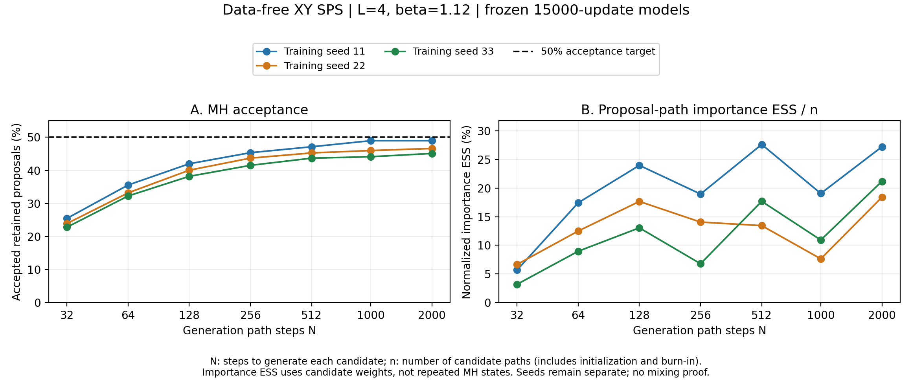
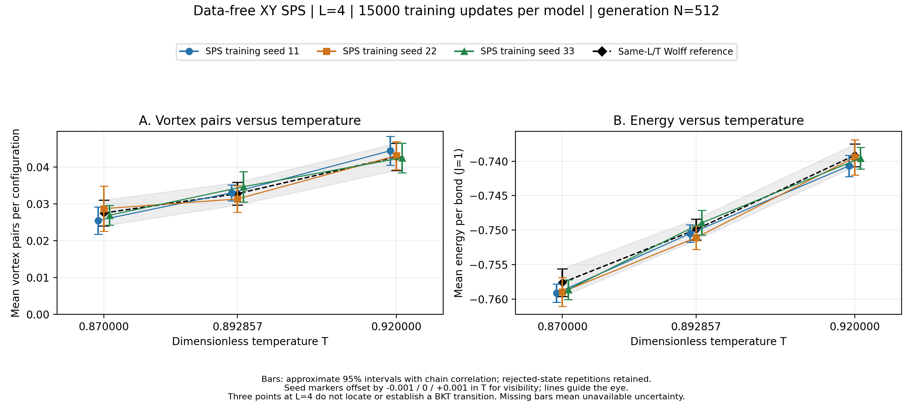
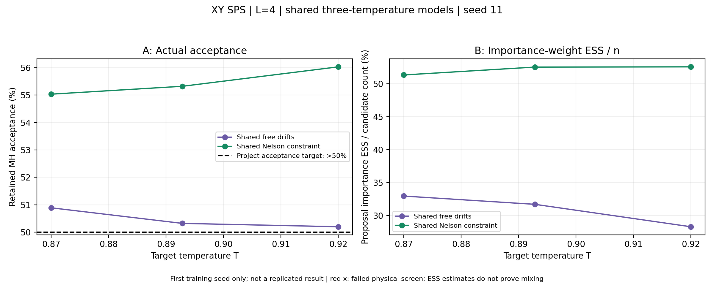
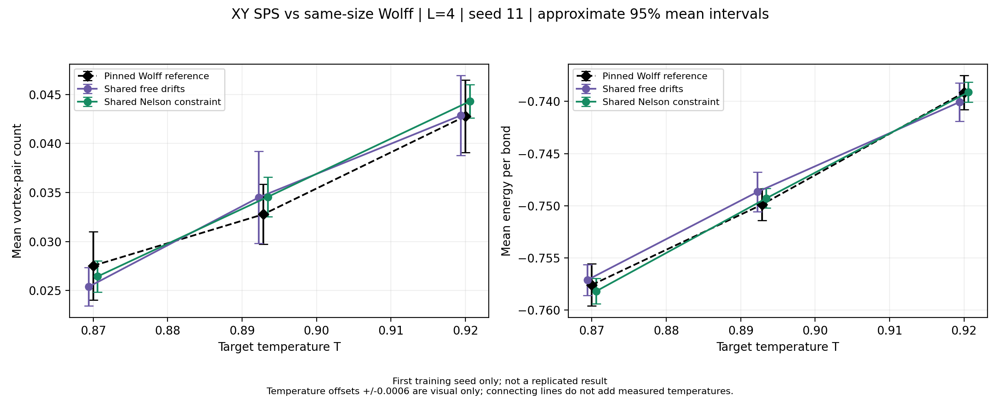
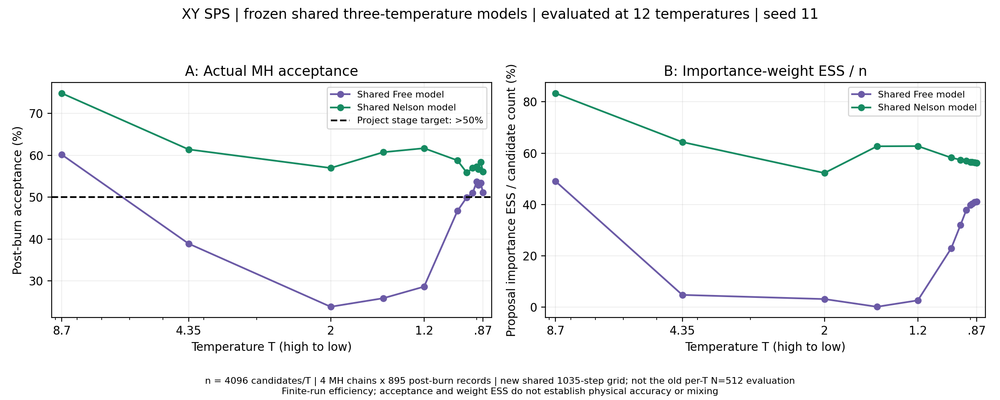
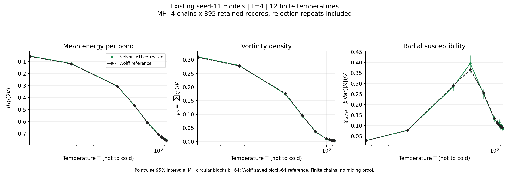
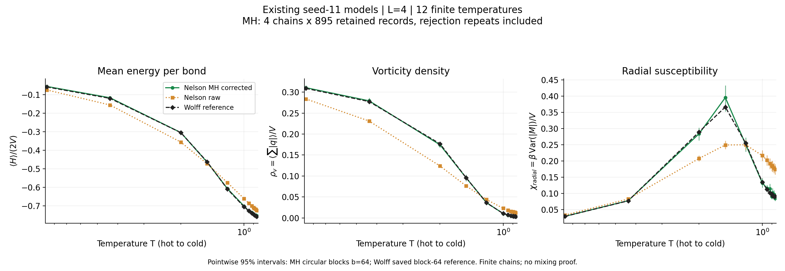

# Current progress: from the baseline to a frozen-model temperature scan

Public summary updated **2026-10-29**, using experiments and saved-data analyses completed by **2026-10-21**. This page curates existing evidence; it does not report new training from the documentation update.

All results below use `L=4`, `J=1`. The **three training seeds** belong to the older single-temperature studies. The newer shared free/Nelson comparison has **one paired training seed, 11**. Wolff configurations remain validation data only.

## 1. Fixed models evaluated through 2,000 generation steps

At `T=1/1.12`, three 15,000-update models were frozen and evaluated at progressively finer discretizations, ending at `N=2000`. This changed candidate generation, not training. Different generation-step settings used protocol-defined evaluation random streams.

| Training seed | Acceptance at N=1000 | At N=2000 | Candidate-weight ESS/n at N=1000 | At N=2000 |
|---|---:|---:|---:|---:|
| 11 | 48.96% | 48.96% | 19.05% | 27.20% |
| 22 | 45.98% | 46.61% | 7.64% | 18.40% |
| 33 | 44.11% | 45.10% | 10.93% | 21.17% |

All three `N=2000` acceptance estimates remained below the 50% project stage target. The selected-observable physical screens passed, but acceptance gains from 1,000 to 2,000 steps were small. Sampling cost approximately doubled, and estimated energy ESS per sampling second decreased for all three models. This is not evidence that infinitely fine paths cannot help, or that increasing candidate-weight ESS/n improves every observable's information rate.

The [complete 21-row table](../../publication/results/path_steps_2000.csv) includes all tested step counts, costs, diagnostics and seeds. Its local absolute-path column was omitted during public export; numeric strings were preserved.

## 2. Three temperatures with separate training

We separately trained three seeds at each of `T=0.87`, `1/1.12`, and `0.92`, holding the 15,000-update budget and `N=512` evaluation setting fixed. This gives **nine single-temperature models**, not a shared model evaluated at nine independently trained conditions.

The nine method/temperature/seed settings passed the specified finite-run physical screening for energy, vortex count, magnetization magnitude and `G(2)`. `G(1)` is redundant with the per-bond energy. Acceptance ranged from **41.97% to 52.61%**; only `T=0.92`, seed 33 exceeded 50%, at **52.61%**. None of this establishes a measured BKT transition or a universally satisfactory acceptance rate.

See the [nine-row public table](../../publication/results/three_temperatures.csv), which retains all seeds and removes only the machine-specific summary-path column.

## 3. Shared-temperature free versus Nelson

Two new models were trained on the same three prefix targets, using 15,000 updates and seed 11. Both arms share the temperature task, forward/noise module initialization and matched path-noise streams:

- **free:** independently learned forward and backward drifts.
- **Nelson:** learned forward drift and noise, with backward drift constructed from the physical score relation.

The free model is an independently trained scientific control, not a model that Nelson must call to run. Comparing only an older single-temperature model with Nelson would confound the backward-drift constraint with the shared-training design. Network capacity also differs, so the comparison does not isolate every possible cause.

| T | free acceptance | Nelson acceptance | free candidate-weight ESS/n | Nelson candidate-weight ESS/n |
|---|---:|---:|---:|---:|
| 0.87 | 50.89% | 55.03% | 32.97% | 51.31% |
| 1/1.12 | 50.32% | 55.32% | 31.72% | 52.50% |
| 0.92 | 50.20% | 56.03% | 28.32% | 52.53% |

This original evaluation used **512 steps separately over each target's absolute time interval**, eight MH chains, 4,096 burn-in attempts and 16,384 retained records per chain. The candidate denominator was 163,848 per target/arm; retained records were 131,072, including rejection repeats. All six settings passed the specified physical screening for the selected observables.

The vortex statistic in this older figure is a **count**, `(n_plus+n_minus)/2`, not a density or a demonstrated spatially bound pair. Per-bond energy is `H/(2V)`.

Nelson had 10,482 trainable parameters versus free's 20,915, but recorded training time was **23.42 versus 19.73 minutes**. Three-temperature sampling took **29.29 versus 24.63 minutes**. These are original-run timings, not a matched hardware-load benchmark or evidence of a speedup over Wolff.

[Six-setting table](../../publication/results/shared_nelson.csv) and [public diagnostic/cost summary](../../publication/results/shared_nelson.json).

## 4. Reuse the frozen models at 12 temperatures

Without retraining, each model generated **4,096 complete paths**, retaining exact frames at `T=8.7, 4.35, 2, 1.5, 1.2, 1, 0.95, 0.92, 0.90, 1/1.12, 0.88, 0.87`. The schedule is `beta(t)=t/0.87`, so `T(t)=0.87/t`; `t=0` is the uniform infinite-temperature prior and is not a finite-temperature point.

The common full mesh has **1,035 transitions**, formed by inserting exact capture times into a 1,024-step base grid. Each temperature uses its own prefix. The nine additional check temperatures were not additional loss endpoints, although training trajectories already traversed those time regions.

The candidate stream was subsequently replayed exactly to accumulate forward/backward prefix scores and form MH records. This replay did **not** add candidates or retrain the models. Each temperature uses its own prefix-weight MH decision, rather than accepting at the lowest temperature once and treating the whole path as corrected.

| Protocol item | This scan |
|---|---|
| All candidates per arm/temperature | 4,096 |
| MH chains | 4 |
| Candidates per chain | 1 initial state plus 1,023 attempted transitions |
| Burn-in | First 128 attempted transitions per chain |
| Retained records | 4 x 895 = 3,580; all rejected-state repeats retained |
| Acceptance denominator | 3,580 retained attempted transitions |
| Candidate-weight ESS/n denominator | All 4,096 candidates, including initialization and burn-in |

Nelson acceptance was **55.87%–74.83%**, and candidate-weight ESS/n was **52.28%–83.35%**. Both estimates were higher than free at every checked temperature in this one evaluation. At `T=1.5`, free's acceptance was **25.87%** and importance ESS/n **0.157%**, versus Nelson's **60.75%** and **62.69%**.

The [complete 24-row efficiency table](../../publication/results/multitemperature_efficiency.csv) preserves both arms. Temperature points share paths and are correlated; the table is not 12 independent training replications. We have not established confidence intervals for a cross-training-seed advantage. The mesh and sample budget differ from the original 512-step-per-temperature evaluation, so their numerical differences cannot be attributed to generation-step count alone.

## 5. Complete sampler: saved MH-chain physics

On 2026-10-21, the saved MH records were analyzed on CPU, without new candidates, MH transitions or training. We evaluated:

$$
e=\frac{H}{2V},\qquad
\rho_v=\frac{1}{V}\sum_p|q_p|,\qquad
\chi_{\mathrm{radial}}=\frac{\beta}{V}
\left(\langle|\mathbf M|^2\rangle-\langle|\mathbf M|\rangle^2\right),
\quad \mathbf M=\sum_i(\cos\theta_i,\sin\theta_i).
$$

Here `V=16`. The susceptibility is a magnetization-modulus fluctuation, not every alternative magnetic response definition. Moments are pooled before computing this nonlinear statistic. In the present charge convention, vortex density is `2 * pair_count / V`; the older count cannot be silently relabeled as density.

At `T=1/1.12`:

| Observable | Nelson MH | MH pointwise 95% interval | Wolff |
|---|---:|---|---:|
| Energy per bond | -0.748482 | [-0.754438, -0.742288] | -0.749897 |
| Vortex density | 0.004818 | [0.003876, 0.005936] | 0.004097 |
| Radial susceptibility | 0.101872 | [0.087638, 0.116608] | 0.093194 |

MH intervals use **chain-stratified circular moving-block bootstrap**, 512 resamples, primary block length 64, with lengths 32 and 128 retained as sensitivity checks. All 895 records per chain are used, including the tail and rejection repeats. Resampling indices are shared across temperatures to retain same-path dependence. The saved Wolff reference has four chains of 4,096 records at each temperature, with block-64 bootstrap estimates.

For Nelson's 36 pointwise comparisons, the largest absolute difference standardized by the combined bootstrap SEM was approximately **1.9265** at primary block length 64. All were within three combined SEM under block lengths 32/64/128. This is a **descriptive screen**, not an equivalence test or a multiplicity-adjusted significance result. The finite records support compatibility for the checked observables, not an equality of full distributions.

The existing finite-chain diagnostics give a minimum single-chain estimated ESS of approximately **93.26**, maximum classical split R-hat **1.00860**, and longest retained rejection streak **27** for Nelson across finite temperatures. The susceptibility chain check uses an influence-function proxy. None is a mixing proof, and fixed-chain bootstrap does not include training-seed variation or rule out longer unseen dependence.

**Free warnings are retained:** seven temperatures triggered chain or long-rejection warnings; the longest observed rejection streak was **215**, exceeding every tested block length. At `T=1.2`, free's energy differed from Wolff by about **3.53 combined SEM**. We do not label both arms as universally physically validated or treat wider intervals as evidence of adequate exploration.

[Observable curves](../../publication/results/mh_observables.csv) and [public estimates, chain diagnostics, rejection warnings and block sensitivity](../../publication/results/mh_observables.json) include both arms.

### Why keep raw proposals?

At the central temperature, Nelson's raw energy was **-0.713446**, vortex density **0.014008**, and radial susceptibility **0.183575**. These differ from the reference more than the corresponding MH estimates above. The raw results diagnose the generator and show that imposing a target score relation does not establish the actual forward intermediate marginals.

The complete algorithm includes MH, so its physical evaluation uses MH output. Raw bias does not by itself invalidate SPS/MH; corrected-observable compatibility does not prove raw equilibrium, general mixing or superior cost. Even matching several raw observables would not ensure favorable path weights or tail coverage.

The [0.87–0.95 linear-axis detail](../../publication/figures/mh_low_temperature.png) helps inspect the low-temperature points. It is not a finite-size-scaling or BKT transition measurement.

## 6. Verification boundaries and next research questions

The saved-data analysis checked 35 input-file hashes against the prior audit, preserving rejected repeats and all records. Five targeted statistical implementation checks passed. Independent point estimates and block-bootstrap checks agreed at representative points. Packaging this public snapshot checks source/output fingerprints; it does not repeat those physical audits.

The original strict cross-platform replay comparator failed on last-bit derived `log1p`/`exp` values. Independent auditing found at most approximately one ULP difference, with identical candidate configurations, retained MH states and acceptance decisions. The original strict failure remains a failure; no frozen guard was relaxed. Complete intermediate micro-trajectories were not saved, so endpoint/accumulated-score verification is not independent recomputation of every transition density from saved full paths.

Useful next questions are whether the paired advantage repeats for training seeds 22/33, how much is attributable to the score constraint versus capacity/optimization changes, and whether improvements persist under matched accuracy and total cost on larger lattices. These are **proposed studies**, not completed results or automatically launched jobs. Three training seeds would require four additional free/Nelson models beyond the current seed-11 pair.

The current evidence does not establish universal Nelson superiority, continuous-temperature correctness, a BKT critical point, elimination of critical slowing down, or speedup over Wolff. [Method and attribution](method.md), [earlier baseline results](results.md), and [publication provenance](../../publication/README.md) provide the remaining context.
